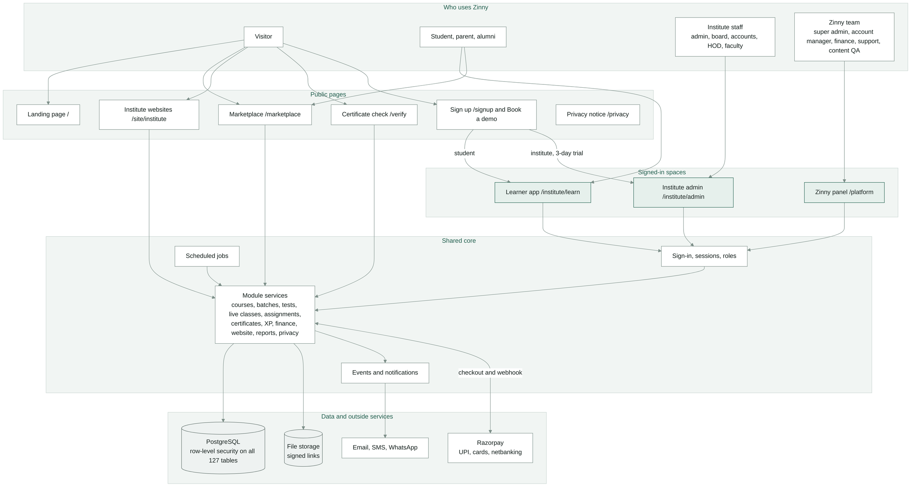
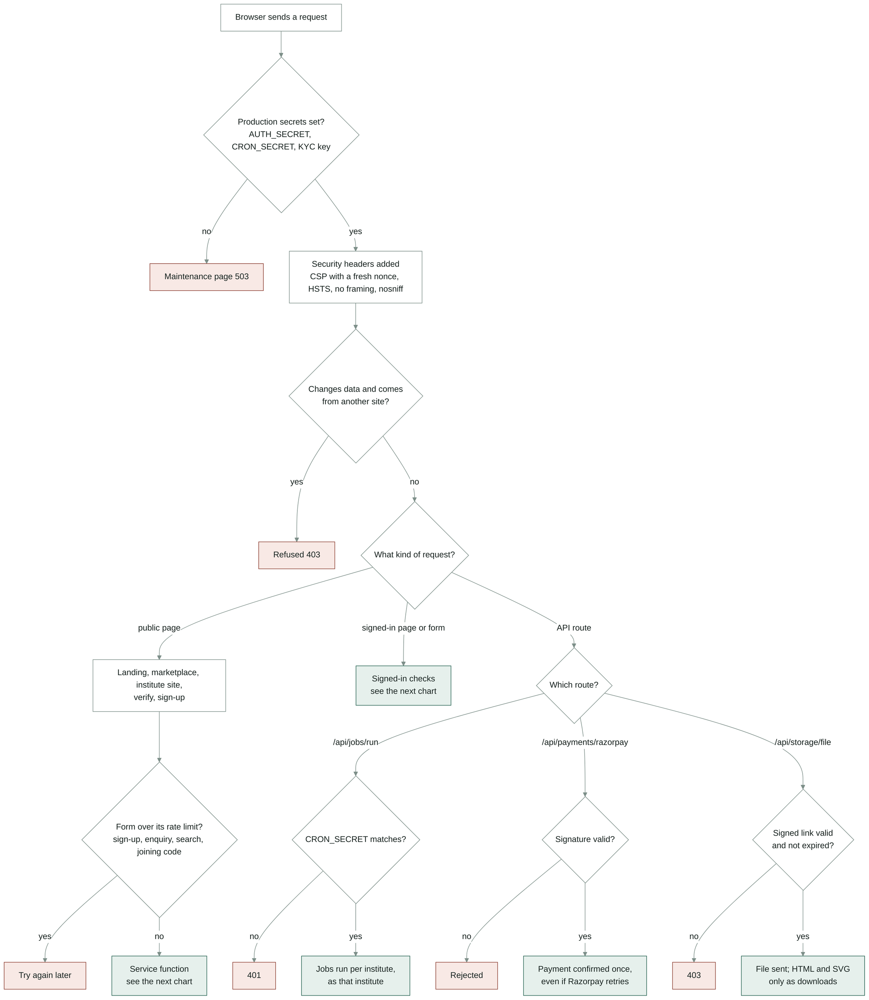
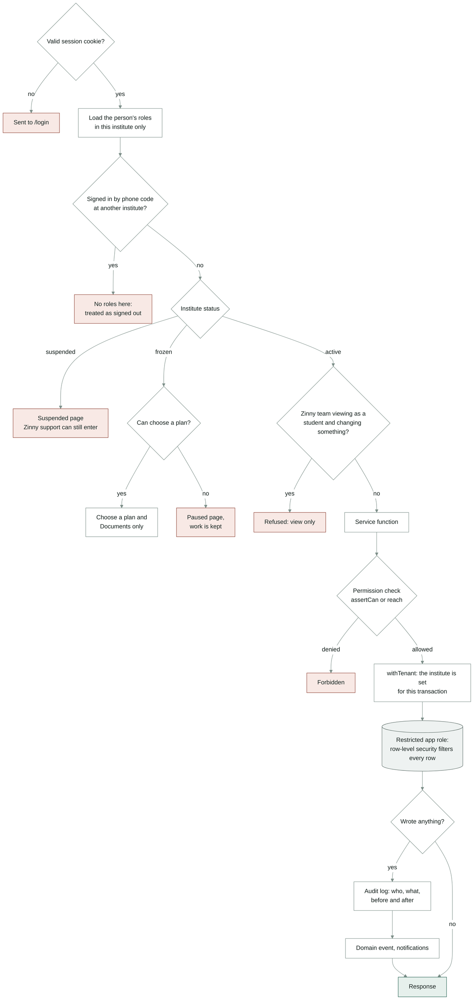
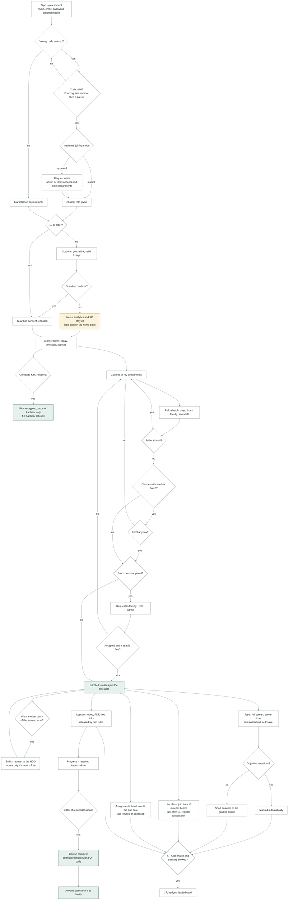
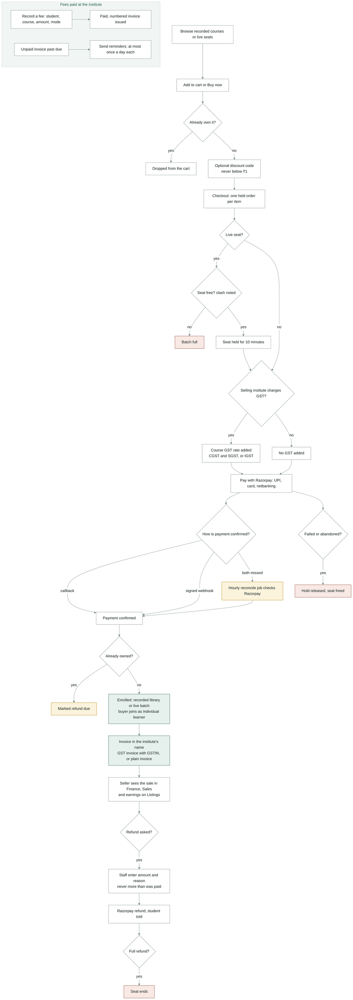
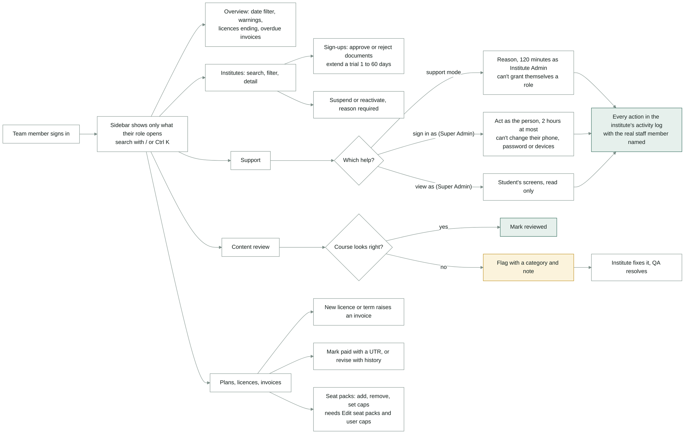
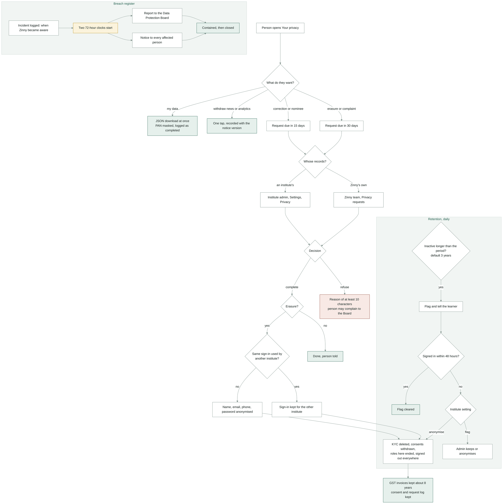
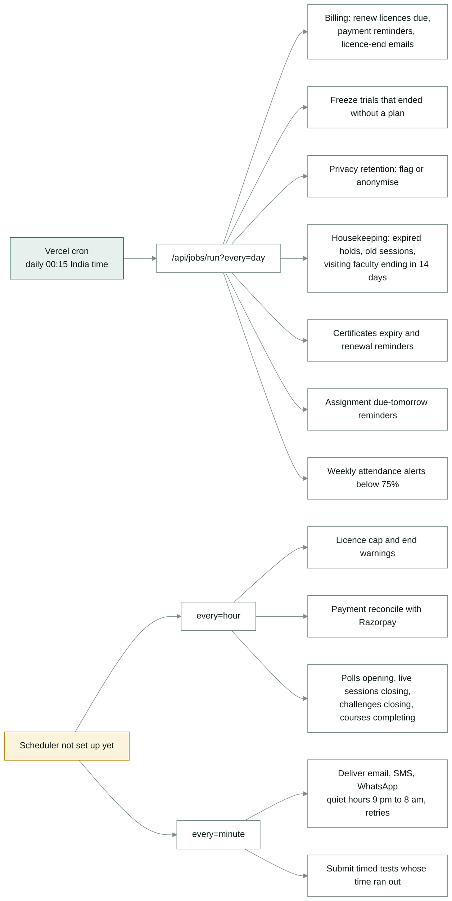

# How Zinny works: flowcharts

Eight flowcharts that follow the code as of November 2026. GitHub draws them as diagrams. The same charts, with notes, are on the shared flowchart page.

## 1. The platform at a glance

Four kinds of people come in through public pages or their own space. Every space calls the same services, and every service reaches the database only through its own institute's walls.

## 2. What every request passes through

Every page load, form or API call goes through the same gates, from the browser down to the database. A request stops at the first gate it fails.

### Signed-in pages and forms

## 3. Institute lifecycle: from sign-up to renewal

An institute can join on its own, try Zinny for 3 days and pay to continue. The Zinny team can also create an institute directly, which skips the trial.

```mermaid
%%{init: {"theme": "base", "flowchart": {"useMaxWidth": false, "curve": "basis", "padding": 14}, "themeVariables": {"primaryColor": "#ffffff", "primaryBorderColor": "#7d8f89", "primaryTextColor": "#17221f", "lineColor": "#7d8f89", "clusterBkg": "#f1f5f3", "clusterBorder": "#c9d5d1", "edgeLabelBackground": "#ffffff", "titleColor": "#1f5d4c"}}}%%
flowchart TD
  classDef ok fill:#e6f0ec,stroke:#1f5d4c,color:#17221f
  classDef warn fill:#fbf3dc,stroke:#b8860b,color:#17221f
  classDef stop fill:#f8e9e5,stroke:#8a3b2e,color:#17221f

  A["Book a demo or Sign up as institute"] --> A1{"Prefer a call?"}
  A1 -- yes --> A2["Request a call form<br/>emailed to every Super Admin"]
  A1 -- no --> S1["Step 1: institute details<br/>name, legal name, type, city, state, address, web address"]
  S1 --> S1a{"Web address free<br/>and not reserved?"}
  S1a -- no --> S1
  S1a -- yes --> S2["Step 2: admin account<br/>contact, email, mobile, strong password"]
  S2 --> S2a{"Email already on Zinny?"}
  S2a -- yes --> S2
  S2a -- no --> S3{"Step 3: does GST apply<br/>when you sell a course?"}
  S3 -- yes --> S3a["GSTIN must match the state"]
  S3 -- no --> S3b["No GSTIN; invoices without tax"]
  S3a & S3b --> S4["Step 4: documents<br/>PAN required; GST certificate, deed, MOA, AOA, licence optional<br/>PDF, JPG or PNG up to 10 MB"]
  S4 --> S5["Consents: account and service required, news optional"]
  S5 --> S6{"Under 5 sign-ups an hour<br/>from this network?"}
  S6 -- no --> S6a["Try again later"]:::stop
  S6 -- yes --> C["Institute, admin and trial created<br/>trial ends on sign-up day + 3"]
  C --> C1["Admin signed in, lands on Documents"]
  C1 --> R["Zinny team reviews each document<br/>approve, or reject with a note"]

  C1 --> T["Trial days 1 to 3<br/>every module works, gold countdown banner"]:::warn
  T --> TJ{"Daily job, 00:15 India time<br/>trial ended and no licence?"}
  TJ -- no --> T
  TJ -- yes --> FR["Frozen<br/>admins: Choose a plan and Documents<br/>everyone else: paused page<br/>nothing deleted"]:::stop
  FR --> EXT{"Zinny extends the trial?<br/>1 to 60 days"}
  EXT -- yes --> T
  FR --> CP["Choose a plan<br/>price, GST and total shown"]
  T --> CP
  CP --> PAN{"Usable PAN on file?"}
  PAN -- no --> C1
  PAN -- yes --> PAY{"Payment gateway"}
  PAY -- "test mode" --> PD["Paid"]
  PAY -- "live keys" --> PL["Contact Zinny, pay by bank transfer"]:::warn
  PL --> PD
  PD --> LIC["Licence created from today<br/>Zinny GST invoice marked paid<br/>status active"]:::ok

  LIC --> USE["Licence active: caps, modules, term"]:::ok
  USE --> CAP{"Students or staff at 90% of a cap?"}
  CAP -- yes --> CAPW["Warning to the Zinny team<br/>caps warn, they don't block"]:::warn
  CAPW --> SP["Admin buys seat packs<br/>25 students or 5 staff, priced for days left"]
  SP --> USE
  USE --> ENDQ{"Days to licence end"}
  ENDQ -- "30, 14, 7, 1" --> REM["Email and notification to admins<br/>gold banner in their panel"]:::warn
  REM --> AR{"Auto-renew on?"}
  AR -- yes --> AP{"Plan still offered?"}
  AP -- yes --> RN["Renewed 15 days before the end<br/>at the plan's price that day, invoiced"]:::ok
  AP -- no --> BL["Renewal blocked warning<br/>team picks a plan"]:::warn
  AR -- no --> MAN["Team uses Renew now, or the licence ends"]
  RN --> USE
  MAN --> USE
  USE --> SUS{"Team suspends with a reason?"}
  SUS -- yes --> SS["Suspended: people kept out, work kept"]:::stop
  SS --> REA["Reactivate"] --> USE
  
```

## 4. Student journey

From creating an account to a verifiable certificate. Each step checks the student's own roles in their institute.

## 5. Marketplace purchase and money

One cart can hold courses from several institutes. Each institute is paid through its own order and issues its own invoice.

## 6. How the Zinny team works

The team runs the platform from /platform and never acts inside an institute without a logged reason.

## 7. Privacy requests, erasure and breaches

Built for India's DPDP Act 2023 and Rules 2025. The institute answers for its learners; Zinny answers for marketplace learners and the people who sign institutes up.

## 8. Background jobs

Jobs run once per institute, as that institute, behind the cron secret. On Vercel's current plan only the daily run is scheduled; the hourly and every-minute runs need a scheduler.

